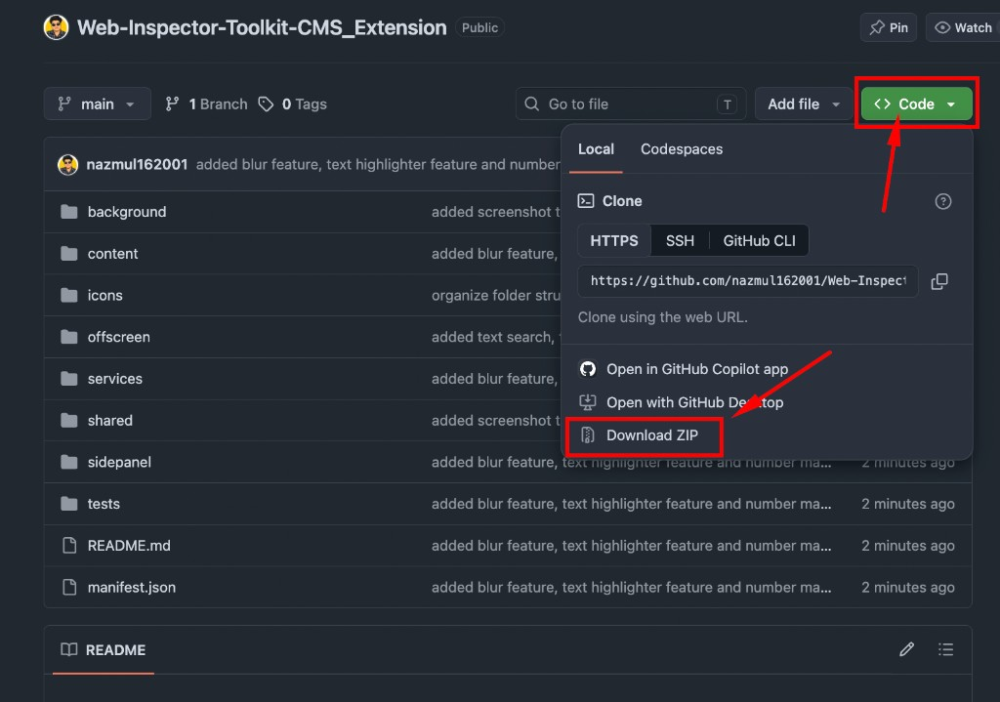
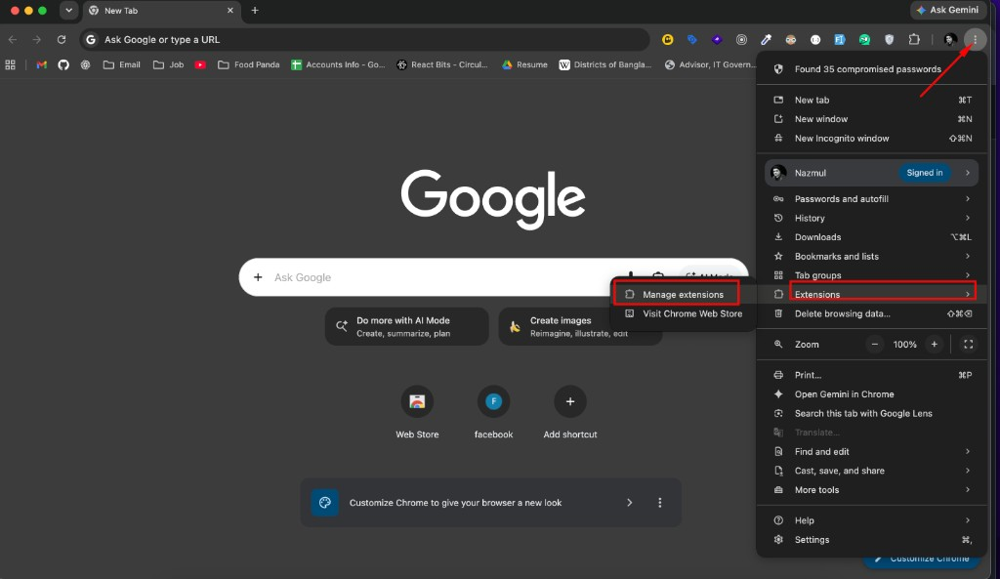
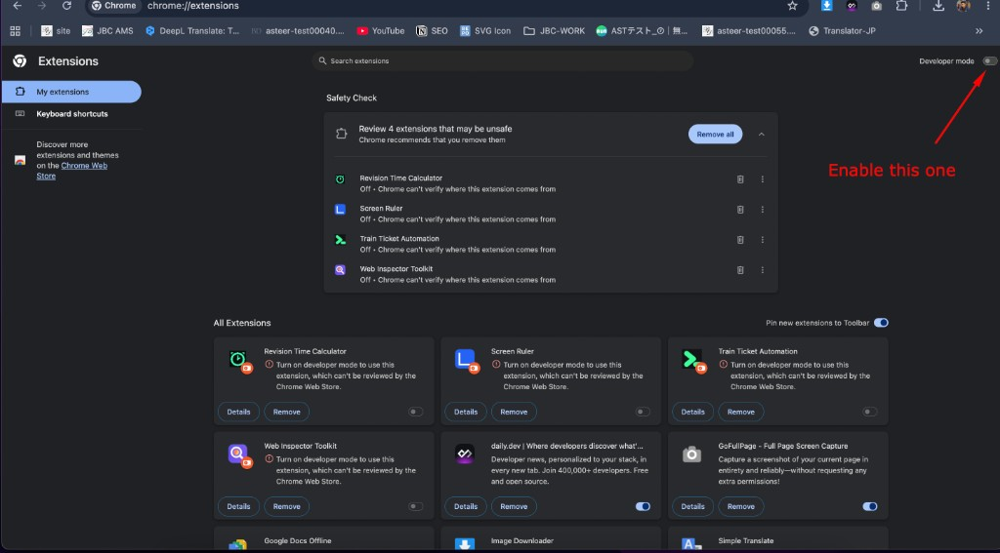
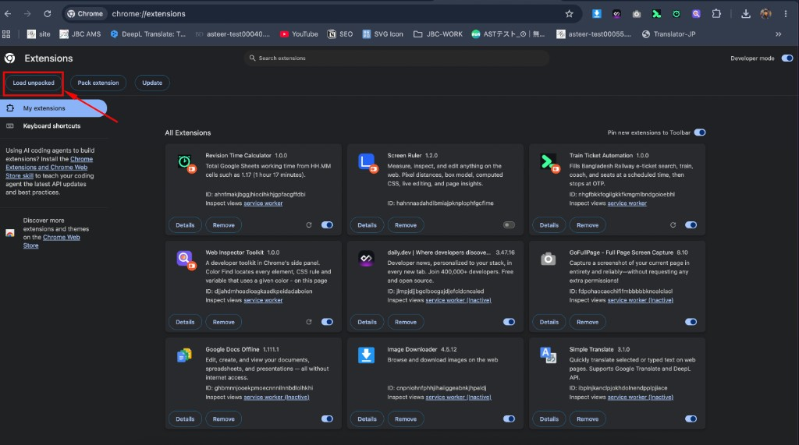
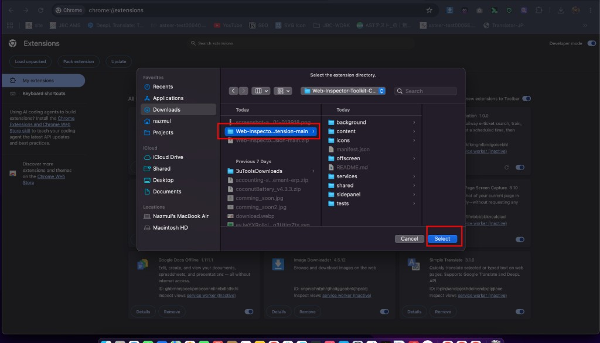
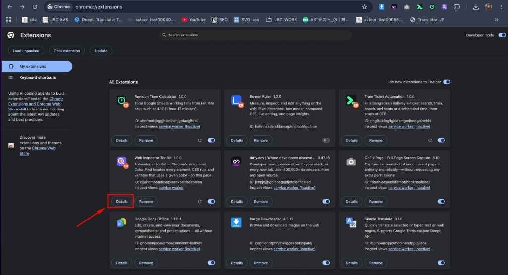
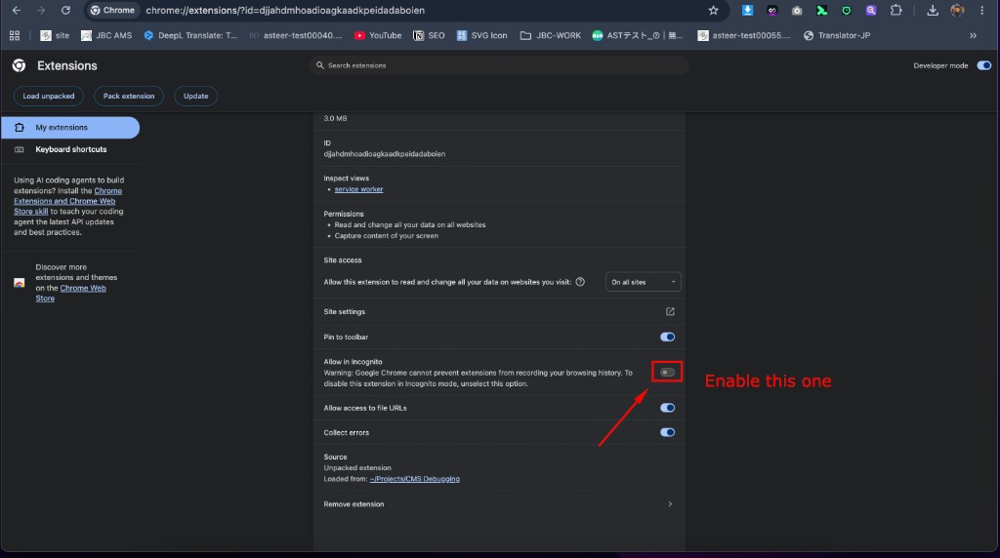

  <a href="./README.md" target="_blank" rel="noopener noreferrer">English</a>
  &nbsp;&nbsp;·&nbsp;&nbsp;
  <strong>日本語</strong>

# Web Inspector Toolkit

Chromeのサイドパネルで、実際のウェブサイトを調べるツールです。色・テキスト・リンク・フォント・画像・スクリーンショットを、**すべて自分の端末の中だけ**で扱います。アップロードはしません。

  

  <strong>Chrome 123+</strong> &nbsp;·&nbsp; <strong>ビルド不要</strong> &nbsp;·&nbsp; <strong>English / 日本語</strong> &nbsp;·&nbsp; <strong>ダーク / ライト</strong>

---

## できること

| | |
| :---: | --- |
| <mark><strong>カラー検索</strong></mark> | 指定した色を使っている要素を、このページまたはサイト全体から見つけます。HEX、`rgb()`、CSSの色名、カラーピッカーに対応。 |
| <mark><strong>テキスト検索</strong></mark> | 人が読んでいるテキストから、単語や文章を検索します。HTMLのソースは対象外です。 |
| <mark><strong>電話番号</strong></mark> | 書き方が違っても同じ番号を見つけます（`080-1234-5678`、`+81 80…`、全角数字、`tel:` リンク）。 |
| <mark><strong>リンク href</strong></mark> | そのアドレスを指しているリンク、ボタン、フォームを見つけます（完全一致 / 部分一致）。 |
| <mark><strong>フォント検索</strong></mark> | そのフォントを使っている要素を表示します。CSSの出典と `@font-face` のファイルも分かります。 |
| <mark><strong>半角 / 全角テキスト</strong></mark> | 全角の数字・英字・記号を見つけ、ページ上で赤くマークします。 |
| <mark><strong>画像の解像度</strong></mark> | 画像や背景にポインターを置くと、実際のピクセルサイズと表示サイズを比べられます。 |
| <mark><strong>スクリーンショット</strong></mark> | ページ全体、今見えている画面、または選択した範囲を撮影し、その場で書き込めます。 • 描画ツール：ペン、直線、矢印、円、長方形、正方形、テキスト • ハイライト（範囲をドラッグしてから色を選ぶ） • 範囲をぼかす • 番号付きの円（クリックで 1、2、3…） • クリップボードにコピー、または PNG で保存 • 「範囲を選択」のショートカット（パネルを開かなくても使えます） |
| <mark><strong>このページ / サイト全体</strong></mark> | 検索ツールは、今開いているタブだけ、または同じサイトを裏で巡回して調べられます。 |
| <mark><strong>English / 日本語</strong></mark> | 画面の言葉を切り替えます。ウェブサイト本体の文章は翻訳しません。 |
| <mark><strong>ダーク / ライト</strong></mark> | 最初はシステムの設定に従い、選んだあとはそのモードを覚えておきます。 |
| <mark><strong>端末内だけで完結</strong></mark> | 検索結果もスクリーンショットも、自分のパソコンに残ります。この拡張機能から外へ通信しません。 |

---

## Chromeへの入れ方

最初に一度だけ行います。あとは、どのウェブサイトでも拡張機能のアイコンをクリックすれば、右側にサイドパネルが開きます。

 

### 1. ZIPをダウンロード

GitHubでこのリポジトリを開きます。

1. 右上の緑の **<> Code** ボタンをクリックします。
2. **Download ZIP** をクリックします。

  

Code → Download ZIP

 

### 2. ZIPを解凍する

ダウンロードフォルダにある `Web-Inspector-Toolkit-CMS_Extension-main.zip` を解凍します。

- **Mac** — ZIPをダブルクリックします。同じ名前のフォルダが隣にできます。
- **Windows** — ZIPを右クリック → **すべて展開…**

Chromeに読み込むのは、**解凍したフォルダ**です。中に `manifest.json` があるものを選びます。

 

### 3. 「拡張機能を管理」を開く

1. **Google Chrome** を開きます。
2. 右上の **⋮** メニューをクリックします。
3. **拡張機能** にポインターを合わせます。
4. **拡張機能を管理** をクリックします。

  

⋮ → 拡張機能 → 拡張機能を管理

 

### 4. デベロッパーモードをオンにする

拡張機能のページの**右上**で、**デベロッパーモード**をオンにします。

  

デベロッパーモードをオン

 

### 5. 解凍したフォルダを読み込む

1. 左上の **パッケージ化されていない拡張機能を読み込む**（Load unpacked）をクリックします。

  

パッケージ化されていない拡張機能を読み込む

2. 解凍したプロジェクトのフォルダを選びます（`manifest.json`、`background`、`content`、`sidepanel` があるフォルダです）。
3. **選択** をクリックします。

  

解凍したフォルダを選んで、選択

拡張機能の一覧に **Web Inspector Toolkit** が表示されます。

 

### 6. シークレットモードでも使う（任意）

シークレットウィンドウでも使いたい場合：

1. 拡張機能のページで、Web Inspector Toolkit のカードにある **詳細** をクリックします。

  

詳細

2. 下へスクロールして、**シークレット モードでの実行を許可する** をオンにします。

  

シークレット モードでの実行を許可する

---

## これで完了です

任意のウェブサイトを開き、Chromeツールバーの **Web Inspector Toolkit** アイコンをクリックすると、右側にサイドパネルが開きます。

アイコンが見当たらないときは、ツールバーのパズルピース（拡張機能）をクリックして、**Web Inspector Toolkit** をピン留めしてください。

ツールがページへのアクセスを初めて必要とするとき、Chromeが一度だけ確認します。許可してから続けてください。
