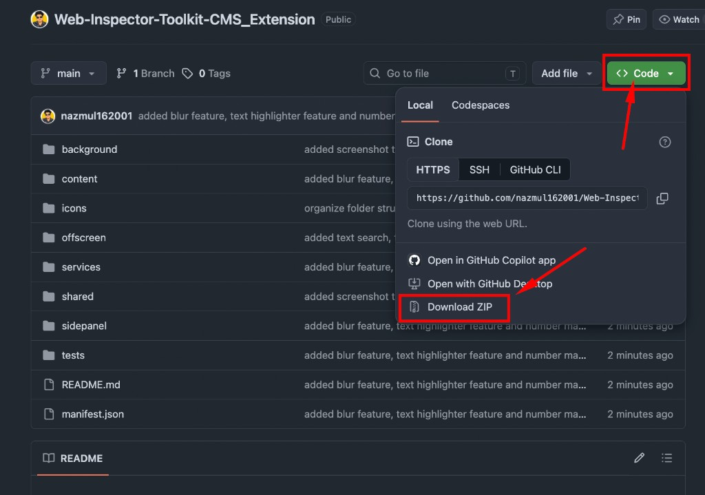
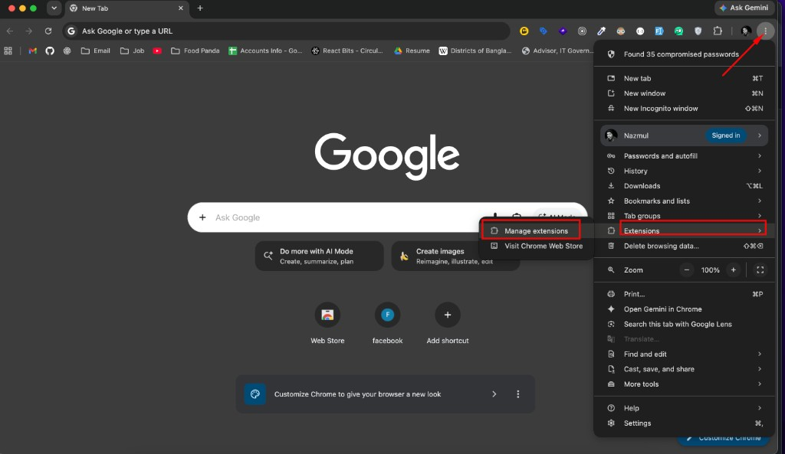
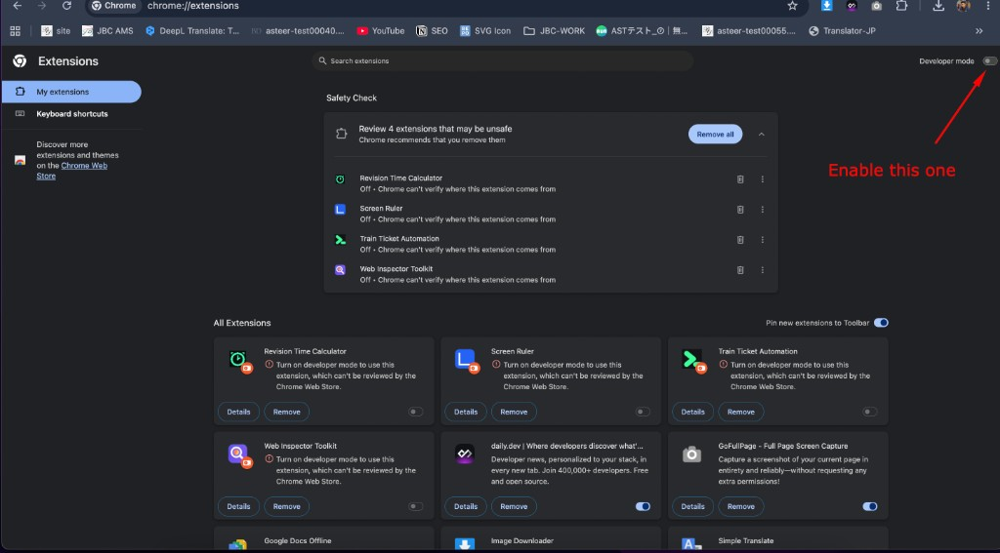
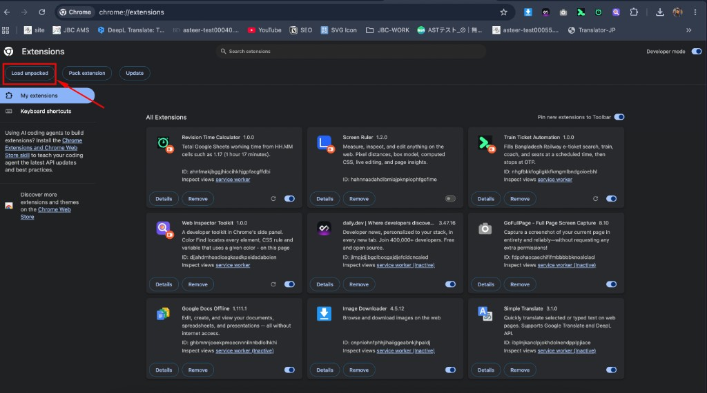
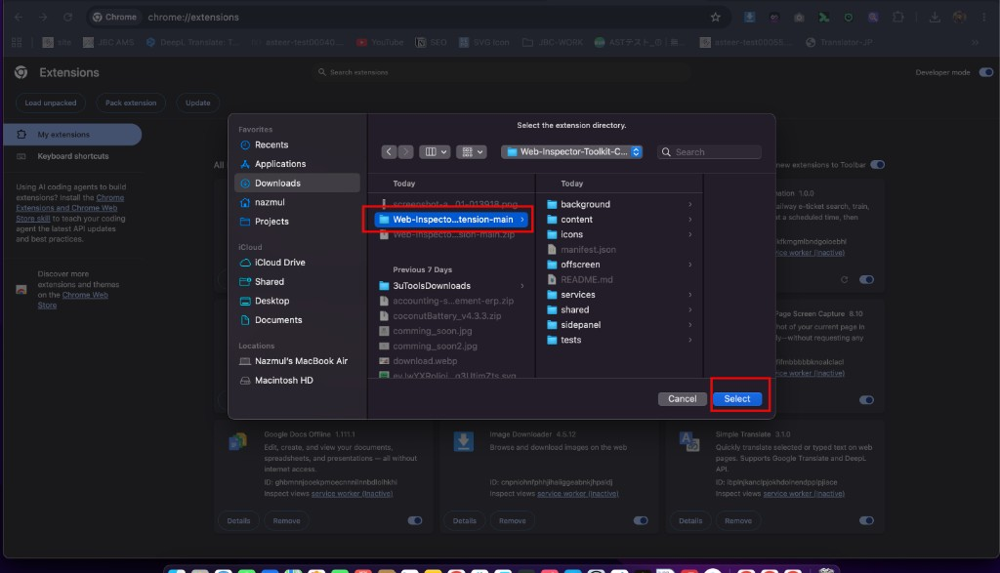
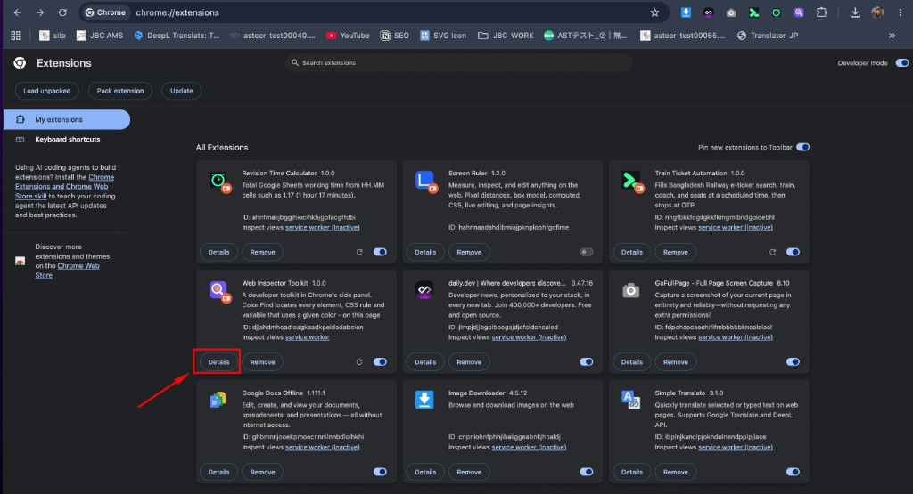
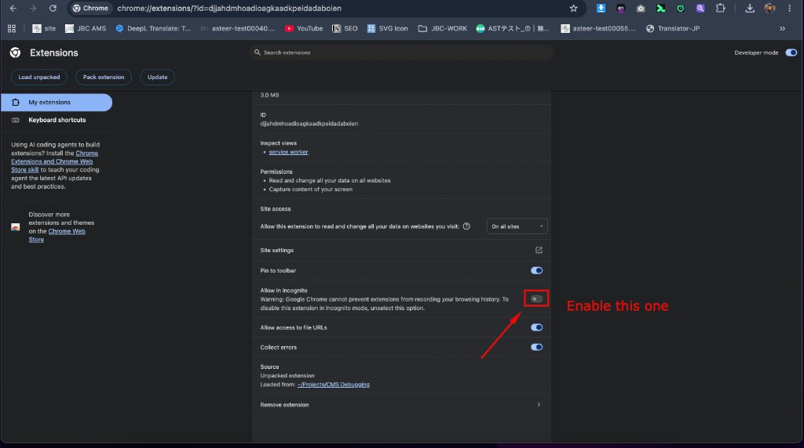

  <strong>English</strong>
  &nbsp;&nbsp;·&nbsp;&nbsp;
  <a href="./README.ja.md" target="_blank" rel="noopener noreferrer">日本語</a>

# Web Inspector Toolkit

A Chrome side-panel toolkit for inspecting real websites — colours, text, links, fonts, images and screenshots — **entirely on your device**. Nothing is uploaded.

  

  <strong>Chrome 123+</strong> &nbsp;·&nbsp; <strong>No build step</strong> &nbsp;·&nbsp; <strong>English / 日本語</strong> &nbsp;·&nbsp; <strong>Dark & light</strong>

---

## Features

| | |
| :---: | --- |
| <mark><strong>Color Find</strong></mark> | Locate every element that uses a colour, on this page or the whole site. Type HEX, `rgb()`, CSS names, or pick a colour. |
| <mark><strong>Text Find</strong></mark> | Search any word or sentence in the text people actually read, not the HTML source. |
| <mark><strong>Telephone Number</strong></mark> | Find a phone number in any format (`080-1234-5678`, `+81 80…`, full-width digits, `tel:` links). |
| <mark><strong>Link href</strong></mark> | Find every link, button or form that points to an address (exact or contains). |
| <mark><strong>Font Find</strong></mark> | See which elements use a font family, including CSS source and `@font-face` files. |
| <mark><strong>Half / Full Width Text</strong></mark> | Find full-width numbers, letters and symbols, and mark them in red on the page. |
| <mark><strong>Image Resolution</strong></mark> | Hover any image or background and see its real pixel size vs how it is shown. |
| <mark><strong>Screenshot Taker</strong></mark> | Capture the full page, the current screen, or a selected area, then mark it up. • Drawing tools: pen, line, arrow, circle, rectangle, square, text • Highlighter (pick a colour after you drag) • Blur any area • Numbered circles (click to place 1, 2, 3…) • Copy to clipboard or save as PNG • Optional keyboard shortcut for Select Area (works without opening the panel) |
| <mark><strong>This Page / Entire Site</strong></mark> | Search tools can scan the tab you are on, or crawl the same site in the background. |
| <mark><strong>English / 日本語</strong></mark> | Switch the whole interface. Page content is never translated. |
| <mark><strong>Dark / light mode</strong></mark> | Follows your system until you pick one. |
| <mark><strong>Private by design</strong></mark> | Scans and screenshots stay on your computer. The extension makes no network calls of its own. |

---

## Install in Chrome

Follow these steps once. After that, click the extension icon on any website to open the side panel.

 

### 1. Download the ZIP

Open this repository on GitHub.

1. Click the green **<> Code** button (top right).
2. Click **Download ZIP**.

  

Code → Download ZIP

 

### 2. Unzip the file

Find `Web-Inspector-Toolkit-CMS_Extension-main.zip` in your Downloads folder and unzip it.

- **Mac** — double-click the ZIP. A folder with the same name appears next to it.
- **Windows** — right-click the ZIP → **Extract All…**

You will load **that unzipped folder** in Chrome — the one that contains `manifest.json`.

 

### 3. Open Manage extensions

1. Open **Google Chrome**.
2. Click the **⋮** menu (top right).
3. Hover **Extensions**.
4. Click **Manage extensions**.

  

⋮ → Extensions → Manage extensions

 

### 4. Turn on Developer mode

On the Extensions page, turn on **Developer mode** in the **top-right corner**.

  

Enable Developer mode

 

### 5. Load the unpacked folder

1. Click **Load unpacked** (top left).

  

Load unpacked

2. Select the unzipped project folder (it must contain `manifest.json`, `background`, `content`, `sidepanel`…).
3. Click **Select**.

  

Select the unzipped folder, then Select

**Web Inspector Toolkit** now appears in your extension list.

 

### 6. Allow it in Incognito (optional)

To use the toolkit in Incognito windows:

1. On the Extensions page, click **Details** on the Web Inspector Toolkit card.

  

Details

2. Scroll down and turn on **Allow in Incognito**.

  

Allow in Incognito

---

## That’s all

Open any website, click the **Web Inspector Toolkit** icon in the Chrome toolbar, and the side panel opens on the right.

If you do not see the icon: click the puzzle-piece (extensions) button in the toolbar, then pin **Web Inspector Toolkit**.

The first time a tool needs page access, Chrome will ask once — accept, then continue.
